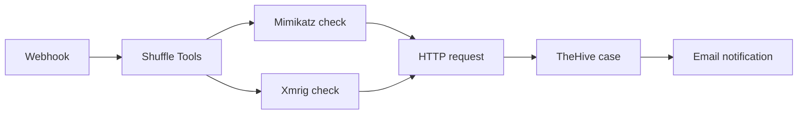

# 🛡️ AI-Powered SOC: UEBA Anomaly Detection + SOAR Automated Response

An end-to-end Security Operations Center pipeline that detects anomalous user behavior with machine learning (UEBA) and triggers automated incident response through SOAR.

> Academic project (PFA), ENSA Khouribga, Cybersécurité et Réseaux Intelligents.

## 📌 Overview

Rule-based detection misses behavior that is "valid" but abnormal. This project builds a **User and Entity Behavior Analytics (UEBA)** pipeline on top of the ELK stack, scores user sessions with an **Isolation Forest**, and sends alerts to a **Shuffle SOAR** workflow that creates cases in **TheHive** and enriches them with a local LLM (**Ollama**).

## 🏗️ Architecture

```
Ubuntu VM (auditd, Sysmon for Linux) ─┐
                                      ├─ Filebeat/Winlogbeat ─► Elasticsearch ─► Kibana
Windows Server 2022 (Sysmon, Logon) ──┘                              │
                                                                     ▼
                                              Feature extraction (session-based)
                                                                     │
                                                                     ▼
                                                Isolation Forest (anomaly score)
                                                                     │
                                                                     ▼
                                          Shuffle SOAR ─► TheHive case + Ollama summary
```

## 🧰 Tech Stack

| Layer | Tools |
|---|---|
| Log collection | Filebeat 7.17.29, Winlogbeat 9.4.3, Sysmon, auditd |
| Storage / SIEM | Elasticsearch 8.x, Kibana |
| ML | Python, scikit-learn (Isolation Forest), pandas |
| Dashboard | Streamlit, Plotly |
| SOAR | Shuffle (Docker), TheHive |
| LLM | Ollama |
| Attack simulation | Kali Linux |

## 🧪 Lab Environment

- **ELK server**: Elasticsearch + Kibana
- **Ubuntu VM**: log source + Shuffle/TheHive (Docker)
- **Windows Server 2022**: log source
- **Kali Linux**: attacker machine

## 🤖 Machine Learning Pipeline

1. **Data cleaning**: removes noise accounts (`NT AUTHORITY\*`, `gdm`, ...) and isolates invalid-user login attempts as a labeled suspicious test set (never used for training).
2. **Session-based feature extraction**: sliding 3-hour overlapping windows, gap-based session logic.
3. **Features:** `failed_login`, `network_connection`, `process_creation`, `command_execution`, `off_hours_ratio`, `novel_event_count`, `day_of_week`
4. **Model selection**: Isolation Forest compared with One-Class SVM and LOF; Isolation Forest chosen.
5. **Training**: time-based split, 210 clean sessions, `n_estimators=300`, `contamination=auto`.

### Results

Evaluated on 80 held-out normal + 11 suspicious sessions (threshold `-0.574880`):

| Metric | Value |
|---|---|
| Accuracy | 94.5% |
| Precision | 87.5% |
| Recall | 63.6% |
| F1-score | 73.7% |
| False Positive Rate | 1.2% |

Confusion matrix: **TN=79, FP=1, FN=4, TP=7**

> ⚠️ The dataset is small and lab-generated; results are indicative, not production benchmarks.

## ⚔️ Attack Simulation

Multi-stage attack executed from Kali against Linux and Windows targets and verified in Kibana, mapped to MITRE ATT&CK:
reconnaissance → brute force → execution → persistence → privilege escalation.

## 📁 Repository Structure

```
.
├── scripts/
│   ├── pipeline/       # clean → features → split → train → final evaluation
│   ├── experiments/    # EDA, model comparison, tuning, threshold sweep
│   └── integration/    # push scores to Elasticsearch, Streamlit dashboard
├── config/             # sanitized Shuffle docker-compose
├── data/sample/        # anonymized sample data
├── docs/screenshots/   # Kibana, Shuffle, TheHive screenshots
├── requirements.txt
├── .env.example
└── README.md
```

## 🚀 Getting Started

```bash
git clone https://github.com/kandjcb/ai-powered-soc-ueba-soar.git
cd ai-powered-soc-ueba-soar
python3 -m venv venv && source venv/bin/activate
pip install -r requirements.txt
```

Credentials are read from environment variables (never hardcoded):

```bash
export ES_HOST="https://YOUR_ELK_IP:9200"
export ES_USER="elastic"
export ES_PASS="********"   # required
```

### 1. Pipeline

```bash
python3 scripts/pipeline/clean_data.py        # clean logs, separate noise & suspicious sets
python3 scripts/pipeline/extract_features.py  # session-based feature extraction
python3 scripts/pipeline/enrich_features.py   # feature enrichment
python3 scripts/pipeline/step5_split.py       # time-based train/test split
python3 scripts/pipeline/step6_train.py       # train Isolation Forest
python3 scripts/pipeline/step8_final.py       # final model + evaluation
```

### 2. Experiments (optional)

```bash
python3 scripts/experiments/eda.py                     # exploratory data analysis
python3 scripts/experiments/compare_models.py          # Isolation Forest vs OC-SVM vs LOF
python3 scripts/experiments/step7_tune.py              # contamination tuning
python3 scripts/experiments/step7b_threshold_sweep.py  # threshold selection
```

### 3. Integration

```bash
python3 scripts/integration/push_to_elk.py             # push anomaly scores to Elasticsearch
streamlit run scripts/integration/dashboard.py         # dashboard
```

> The full datasets are not included (real lab logs). See `data/sample/` for the expected format.

## 🤖 SOAR Workflow (Automated Incident Response)

When a session is flagged as anomalous, the response is automated with **Shuffle**.

Shuffle workflow



### How it works

1. **Webhook trigger:** the Kibana alert (anomalous session from the UEBA model) calls the Shuffle webhook with the event data.
2. **Shuffle Tools:** parses the incoming alert and prepares the data for the next steps.
3. **Parallel threat checks:** two branches run at the same time, one looking for **Mimikatz** (credential dumping) and one for **Xmrig** (crypto-mining) indicators.
4. **HTTP node:** merges the results of both branches into a single request.
5. **TheHive:** creates a case with the alert details and findings, so an analyst can investigate immediately.
6. **Email:** notifies the analyst that a new case was created.

### Deployment notes

- Shuffle runs with Docker on the Ubuntu VM (`config/docker-compose.yml`).
- OpenSearch (used by Shuffle) needs `vm.max_map_count=262144`.
- Credentials are supplied through environment variables and are never committed.

## 🔧 Known Issues & Lessons Learned

- Shuffle's OpenSearch needs `vm.max_map_count=262144`.
- Port conflicts between Shuffle, Kibana, and TheHive required remapping.
- Kibana Basic license blocks webhook connectors; solved with the 30-day trial.
- Session window tuning (20-min and 45-min caps) confirmed the original gap-based logic as best.

## 🗺️ Roadmap (towards)

- [ ] Larger and more diverse dataset
- [ ] Improve recall (feature engineering, ensembles)
- [ ] Automated response playbooks (block IP, disable account)
- [ ] Real-time scoring service

## ⚠️ Disclaimer

For educational purposes. Attack simulations were performed only in an isolated lab environment.

## 👤 Author

**Mohamed Kacim El Afi**
[GitHub](https://github.com/kandjcb)


